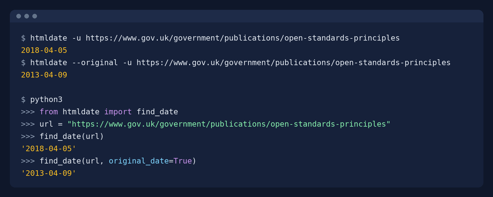

Htmldate: Find the Publication Date of Web Pages
================================================

.. image:: https://img.shields.io/pypi/v/htmldate.svg
    :target: https://pypi.python.org/pypi/htmldate
    :alt: Python package

.. image:: https://img.shields.io/pypi/pyversions/htmldate.svg
    :target: https://pypi.python.org/pypi/htmldate
    :alt: Python versions

.. image:: https://img.shields.io/codecov/c/github/adbar/htmldate.svg
    :target: https://codecov.io/gh/adbar/htmldate
    :alt: Code Coverage

.. image:: https://static.pepy.tech/badge/htmldate/month
    :target: https://pepy.tech/project/htmldate
    :alt: Downloads

.. image:: https://img.shields.io/badge/JOSS-10.21105%2Fjoss.02439-brightgreen
   :target: https://doi.org/10.21105/joss.02439
   :alt: JOSS article reference DOI: 10.21105/joss.02439

.. image:: https://img.shields.io/endpoint?url=https://raw.githubusercontent.com/astral-sh/ruff/main/assets/badge/v2.json
   :target: https://github.com/astral-sh/ruff
   :alt: Ruff

|

Find **original and updated publication dates** of any web page.
It is often not possible to do it using just the URL or the server response.

**On the command-line or with Python**, all the steps needed from web page
download to HTML parsing, scraping, and text analysis are included.

The package is used in production on millions of documents and integrated into
`thousands of projects <https://github.com/adbar/htmldate/network/dependents>`_.

In a nutshell
-------------

|

|

With Python:

.. code-block:: python

    >>> from htmldate import find_date
    >>> find_date('https://www.gov.uk/government/publications/open-standards-principles')
    '2018-04-05' # may change
    >>> find_date('https://www.gov.uk/government/publications/open-standards-principles', original_date=True)
    '2013-04-09'

On the command-line:

.. code-block:: bash

    $ htmldate -u https://www.gov.uk/government/publications/open-standards-principles
    2018-04-05
    $ htmldate --original -u https://www.gov.uk/government/publications/open-standards-principles
    2013-04-09

Features
--------

-  Multilingual, robust and efficient (used in production on millions of documents)
-  URLs, HTML files, or HTML trees are given as input (includes batch processing)
-  Output as string in any date format (defaults to `ISO 8601 YMD <https://en.wikipedia.org/wiki/ISO_8601>`_)
-  Detection of both original and updated dates
-  Compatible with Python 3.10 and later

How it works
~~~~~~~~~~~~

``htmldate`` examines markup and text, from the most to the least reliable sources, and stops at the first valid date:

1. **URL**: a complete date in the URL, given with the ``url`` parameter or found in the canonical link
2. **Header markup**: ``meta`` and ``link`` elements, including `Open Graph protocol <http://ogp.me/>`_ attributes and a large number of CMS idiosyncrasies, then JSON-LD structured data
3. **Document structure**: ``abbr`` elements, elements whose class, id or itemprop suggest a date (e.g. ``entry-date`` or ``byline``), the title and ``h1`` headings, then ``time`` elements
4. **Patterns in the code**: timestamps, dates in image file names and CMS-specific expressions
5. **Text**: in ``extensive`` mode, all text segments are parsed and a disambiguation algorithm determines the most probable date, with copyright and year mentions as a last resort. The ``fast`` mode only accepts a year-month-day date at this stage

Each date is checked for plausibility, within the bounds set by ``min_date`` and ``max_date``.
The library outputs either the last update (the default) or the original publication date, in the desired format.

Markup-based extraction is multilingual by nature.
Text-based refinements support English, French, German, Indonesian, Polish, Russian, Turkish and Chinese, Japanese and Korean dates in year-month-day order.
The extensive mode covers further languages with `dateparser <https://github.com/scrapinghub/dateparser>`_, see the `options page <options.html>`_.

Installation
------------

Main package
~~~~~~~~~~~~

This Python package is tested on Linux, macOS and Windows systems, it is compatible with Python 3.10 upwards. It is available on the package repository `PyPI <https://pypi.org/>`_ and can notably be installed with ``pip``:

.. code-block:: bash

    $ pip install htmldate
    $ pip install --upgrade htmldate # to make sure you have the latest version
    $ pip install git+https://github.com/adbar/htmldate.git # latest available code (see build status above)

The last version to support Python 3.6 and 3.7 is ``htmldate==1.8.1``; for Python 3.8 and 3.9 use the ``1.9.x`` series.

Optional
~~~~~~~~

The ``speed`` extra adds ``faust-cchardet`` for faster encoding detection and Brotli support for compressed downloads. They may not work on all platforms and have thus been singled out although installation is recommended:

.. code-block:: bash

    $ pip install "htmldate[speed]"

The original ``cchardet`` package is also detected if it is installed.

With Python
-----------

``find_date`` is the only function needed, see the examples above.
The `options page <options.html>`_ describes every parameter with examples, and the `core functions page <corefunctions.html>`_ documents the function itself.

On the command-line
-------------------

A command-line interface is included:

.. code-block:: bash

    $ htmldate -u https://blog.python.org/2016/12/python-360-is-now-available
    2016-12-23
    $ wget -qO- "https://blog.python.org/2016/12/python-360-is-now-available" | htmldate
    2016-12-23

For usage instructions see ``htmldate -h``:

.. code-block:: bash

    $ htmldate --help
    usage: htmldate [-h] [-f] [-i INPUTFILE] [--original] [-min MINDATE]
                    [-max MAXDATE] [-u URL] [-v] [--version]

    options:
      -h, --help            show this help message and exit
      -f, --fast            fast mode: disable extensive search
      -i INPUTFILE, --inputfile INPUTFILE
                            name of input file for batch processing (similar to
                            wget -i)
      --original            original date prioritized
      -min MINDATE, --mindate MINDATE
                            earliest acceptable date (ISO 8601 YMD)
      -max MAXDATE, --maxdate MAXDATE
                            latest acceptable date (ISO 8601 YMD)
      -u URL, --URL URL     custom URL download
      -v, --verbose         increase output verbosity
      --version             show version information and exit

The batch mode ``-i`` takes one URL per line as input and returns one result per line in tab-separated format:

.. code-block:: bash

    $ htmldate --fast -i list-of-urls.txt
    https://www.gov.uk/government/publications/open-standards-principles	2018-04-05
    https://example.org/page-without-date	None

License
-------

This package is distributed under the `Apache 2.0 license <https://www.apache.org/licenses/LICENSE-2.0.html>`_.

Versions prior to v1.8.0 are under GPLv3+ license.

Context and contributions
-------------------------

Initially launched to create text databases for research purposes
at the Berlin-Brandenburg Academy of Sciences (DWDS and ZDL units),
this project continues to be maintained but its future development
depends on community support.

**If you value this software or depend on it for your product, consider
sponsoring it and contributing to its codebase**. Your support
`on GitHub <https://github.com/sponsors/adbar>`_ or `ko-fi.com <https://ko-fi.com/adbarbaresi>`_
will help maintain and enhance this package.
Visit the `Contributing page <https://github.com/adbar/htmldate/blob/master/CONTRIBUTING.md>`_
for more information.

Reach out via the software repository or the `contact page
<https://adrien.barbaresi.eu/>`_ for inquiries, collaborations, or feedback.

.. image:: https://img.shields.io/badge/JOSS-10.21105%2Fjoss.02439-brightgreen
   :target: https://doi.org/10.21105/joss.02439
   :alt: JOSS article reference DOI: 10.21105/joss.02439

.. image:: https://img.shields.io/badge/DOI-10.5281%2Fzenodo.3459599-blue
   :target: https://doi.org/10.5281/zenodo.3459599
   :alt: Zenodo archive DOI: 10.5281/zenodo.3459599

.. code-block:: shell

    @article{barbaresi-2020-htmldate,
      title = {{htmldate: A Python package to extract publication dates from web pages}},
      author = "Barbaresi, Adrien",
      journal = "Journal of Open Source Software",
      volume = 5,
      number = 51,
      pages = 2439,
      url = {https://doi.org/10.21105/joss.02439},
      publisher = {The Open Journal},
      year = 2020,
    }

-  Barbaresi, A. "`htmldate: A Python package to extract publication dates from web pages <https://doi.org/10.21105/joss.02439>`_", Journal of Open Source Software, 5(51), 2439, 2020. DOI: 10.21105/joss.02439
-  Barbaresi, A. "`Generic Web Content Extraction with Open-Source Software <https://hal.archives-ouvertes.fr/hal-02447264/document>`_", Proceedings of KONVENS 2019, Kaleidoscope Abstracts, 2019.
-  Barbaresi, A. "`Efficient construction of metadata-enhanced web corpora <https://hal.archives-ouvertes.fr/hal-01371704v2/document>`_", Proceedings of the `10th Web as Corpus Workshop (WAC-X) <https://www.sigwac.org.uk/wiki/WAC-X>`_, 2016.

Going further
-------------

Known caveats
~~~~~~~~~~~~~

The granularity may not always match the desired output format.
If only the year or the month could be found and the chosen format requires a day, the result is padded to the first day of the year or month: ``2017`` becomes ``2017-01-01``.

Besides, there are pages for which no date can be found, ever:

.. code-block:: python

    >>> from htmldate import find_date
    >>> find_date('https://example.com')
    >>>

If the date is nowhere to be found, it might be worth considering `carbon dating <https://github.com/oduwsdl/CarbonDate>`_ the web page, however this is computationally expensive. In addition, `datefinder <https://github.com/akoumjian/datefinder>`_ features pattern-based date extraction for texts written in English.

.. toctree::
   :maxdepth: 2

   corefunctions
   evaluation
   options
   used-by
