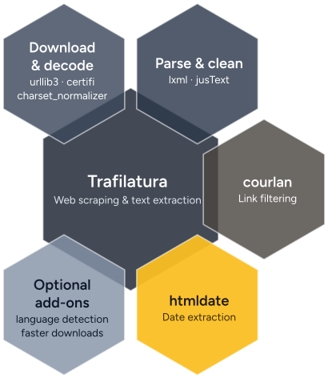
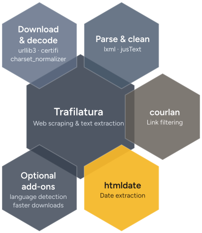

Uses & citations
================

.. meta::
    :description lang=en:
        Htmldate is used at several institutions, included in other software packages and cited in research publications. This page lists projects and publications mentioning the library.

Htmldate is used at several institutions, included in other software packages and cited in research publications. This page lists projects and publications mentioning the library.

To add further references, please `edit this page <https://github.com/adbar/htmldate/edit/master/docs/used-by.rst>`_ and suggest changes.

Notable projects using this software
------------------------------------

Institutional users
^^^^^^^^^^^^^^^^^^^

- `Media Cloud platform <https://mediacloud.org>`_ for media analysis through its `metadata-lib <https://github.com/mediacloud/metadata-lib>`_ package
- Google Research's `FinanceHarness <https://github.com/google-research/google-research/tree/master/finance_harness>`_ which dates every article of its corpus to enforce point-in-time access
- The National Library of Norway's `maalfrid_toolkit <https://github.com/NationalLibraryOfNorway/maalfrid_toolkit>`_ which dates crawled public sector documents for the Målfrid project on Bokmål and Nynorsk usage
- The Internet Archive's `sandcrawler <https://github.com/internetarchive/sandcrawler>`_ which crawls and processes the scholarly web for the `Fatcat catalog <https://fatcat.wiki/>`_ of research publications
- `SciencesPo médialab <https://medialab.sciencespo.fr>`_ through its `Minet <https://github.com/medialab/minet>`_ webmining package

Open-source applications
^^^^^^^^^^^^^^^^^^^^^^^^

- `SurfSense <https://github.com/MODSetter/SurfSense>`_, an open-source alternative to NotebookLM, in its web crawl connector
- `claude-seo <https://github.com/AgriciDaniel/claude-seo>`_, an SEO skill for Claude Code, for publication date detection
- `graham-essays <https://github.com/ofou/graham-essays>`_ which dates each Paul Graham essay in its EPUB and PDF collection

Various repositories
^^^^^^^^^^^^^^^^^^^^

- see `dependency graph on GitHub <https://github.com/adbar/htmldate/network/dependents>`_

Citations in papers
-------------------

**To reference this software in a publication please cite the following paper:**

- Barbaresi, A. "`htmldate: A Python package to extract publication dates from web pages <https://doi.org/10.21105/joss.02439>`_", *Journal of Open Source Software*, 5(51), 2439, 2020. DOI: 10.21105/joss.02439

.. image:: https://joss.theoj.org/papers/10.21105/joss.02439/status.svg
   :target: https://doi.org/10.21105/joss.02439
   :alt: JOSS article

.. image:: https://zenodo.org/badge/DOI/10.5281/zenodo.3459599.svg
   :target: https://doi.org/10.5281/zenodo.3459599
   :alt: Zenodo archive

.. code-block:: shell

    @article{barbaresi-2020-htmldate,
      title = {{htmldate: A Python package to extract publication dates from web pages}},
      author = "Barbaresi, Adrien",
      journal = "Journal of Open Source Software",
      volume = 5,
      number = 51,
      pages = 2439,
      url = {https://doi.org/10.21105/joss.02439},
      publisher = {The Open Journal},
      year = 2020,
    }

Publications citing Htmldate
----------------------------

- Ariyarathne, G., & Nwala, A. C. (2024). 3DLNews: A Three-decade Dataset of US Local News Articles. In Proceedings of the 33rd ACM International Conference on Information and Knowledge Management (CIKM) (pp. 5328-5332), DOI: 10.1145/3627673.3679165.
- Artioli, P., Dentamaro, V., Galantucci, S., et al. (2025). SIEVE: Generating a cybersecurity log dataset collection for SIEM event classification. Computer Networks, 266, 111330, DOI: 10.1016/j.comnet.2025.111330.
- Do, L. T., Taleka, B., Bhutta, H. A., et al. (2026). IRB: Automated Generation of Robust Factuality Benchmarks. arXiv preprint arXiv:2602.08070.
- Grabovoy, A., Bakhteev, O., & Chekhovich, Y. (2021). "The automatic approach for scientific papers dating," 2021 Ivannikov Ispras Open Conference (ISPRAS), pp. 107-113, IEEE, DOI: 10.1109/ISPRAS53967.2021.00020.
- Hanley, H. W., Kumar, D., & Durumeric, Z. (2023). Happenstance: Utilizing Semantic Search to Track Russian State Media Narratives about the Russo-Ukrainian War On Reddit. In Proceedings of the international AAAI conference on web and social media (Vol. 17, pp. 327-338).
- Hanley, H. W., Kumar, D., & Durumeric, Z. (2023). A Golden Age: Conspiracy Theories' Relationship with Misinformation Outlets, News Media, and the Wider Internet. Proceedings of the ACM on Human-Computer Interaction, 7(CSCW2), 1-33.
- Hanley, H. W., Kumar, D., & Durumeric, Z. (2023). "A Special Operation": A Quantitative Approach to Dissecting and Comparing Different Media Ecosystems' Coverage of the Russo-Ukrainian War. In Proceedings of the international AAAI conference on web and social media (Vol. 17, pp. 339-350).
- Hanley, H. W., & Durumeric, Z. (2024). Machine-Made Media: Monitoring the Mobilization of Machine-Generated Articles on Misinformation and Mainstream News Websites. In Proceedings of the international AAAI conference on web and social media (Vol. 18, pp. 542-556).
- Hanley, H. W., & Durumeric, Z. (2024). Partial Mobilization: Tracking Multilingual Information Flows amongst Russian Media Outlets and Telegram. In Proceedings of the international AAAI conference on web and social media (Vol. 18, pp. 528-541).
- Hanley, H. W., Kumar, D., & Durumeric, Z. (2024). Specious Sites: Tracking the Spread and Sway of Spurious News Stories at Scale. In 2024 IEEE Symposium on Security and Privacy (SP) (pp. 1609-1627), DOI: 10.1109/SP54263.2024.00171.
- Hanley, H. W., Lu, Y., & Pan, J. (2025). Across the firewall: Foreign media's role in shaping Chinese social media narratives on the Russo-Ukrainian War. Proceedings of the National Academy of Sciences, 122(1), e2420607122, DOI: 10.1073/pnas.2420607122.
- Hanley, H. W., Okabe, E., & Durumeric, Z. (2025). Tracking the Takes and Trajectories of English-Language News Narratives across Trustworthy and Worrisome Websites. In 34th USENIX Security Symposium (USENIX Security 25) (pp. 5111-5130).
- He, S. S., Ardi, C., Govindan, R., & Madhyastha, H. V. (2026). DeGenTWeb: A First Look at MGT-dominant Websites. arXiv preprint arXiv:2605.00087.
- Kupershtein, L., Zalepa, O., Sorokolit, V., & Prokopenko, S. (2025). AI-agent-based system for fact-checking support using large language models. In Proceedings of the 7th Workshop for Young Scientists in Computer Science & Software Engineering (CS&SE@SW 2024), CEUR Workshop Proceedings Vol. 3917 (pp. 321-331), DOI: 10.55056/ceur-ws.org/vol-3917/paper50.pdf.
- Kupi, M. (2021). "Late to the Party? Agile Methods in British and German Government Institutions", Master’s thesis, Hertie School Berlin.
- Lin, Y.-C., Liu, Z., & Shang, Y. (2026). NSTS: A Neuro-Symbolic System for Webpage Validity Timestamp Determination. In Proceedings of the 26th ACM/IEEE Joint Conference on Digital Libraries (JCDL), DOI: 10.1145/3805696.3846014.
- Liu, Z., Shi, Z., Sang, Y., et al. (2026). Adaptive Auto-Harness: Sustained Self-Improvement for Agentic System Deployment on Open-Ended Task Streams. arXiv preprint arXiv:2606.01770.
- Olier, J. S., & Spadavecchia, C. (2024). Migration and emotions in the media: can socioeconomic indicators predict emotions in images associated with immigrants?. Journal of Computational Social Science, 1-32.
- Singh, I., Bontcheva, K., & Scarton, C. (2021). The False COVID-19 Narratives That Keep Being Debunked: A Spatiotemporal Analysis. arXiv preprint arXiv:2107.12303.
- Smits, T., & Ros, R. (2021). "Distant reading 940,000 online circulations of 26 iconic photographs", New Media & Society, DOI: 10.1177/14614448211049459.
- Smits, T., & Ros, R. (2021). Dataset belonging to the article "Does transnational contention lead to transnational memory? The online visual memory of the February 2003 anti-Iraq War protests". Zenodo, DOI: 10.5281/zenodo.4534377.
- Smits, T., & Ros, R. (2023). Space and Place in Online Visual Memory: The Tank Man in Hong Kong. The Visual Memory of Protest, Amsterdam University Press.
- Stefanovitch, N. (2022). Team TMA at SemEval-2022 Task 8: Lightweight and Language-Agnostic News Similarity Classifier. In Proceedings of the 16th International Workshop on Semantic Evaluation (SemEval-2022) (pp. 1178-1183).
- Tønnessen, J. C., & Birkenes, M. B. (2024). Providing Web Archive News Articles as Corpus Data. Journal of Open Humanities Data, DOI: 10.5334/johd.281.
- Ullrich, H., & Drchal, J. (2026). AIC CTU@AVerImaTeC: dual-retriever RAG for image-text fact checking. In Proceedings of the Ninth Fact Extraction and VERification Workshop (FEVER) (pp. 136-142), DOI: 10.18653/v1/2026.fever-1.11.
- Viduka, D., Ličina, B., & Ilić, L. (2021). Choosing the best Python web framework for beginner according to experienced users. In 11th International Conference on Applied Information and Internet Technologies (p. 100-103).
- Xiao, Y., Han, R., Chen, Y., et al. (2026). FinanceHarness: Autonomous Financial Deep Research Framework. In Findings of the Association for Computational Linguistics: EMNLP 2026 (pp. 48172-48197), DOI: 10.18653/2026.findings-emnlp.2251.

Ports
-----

Go port
    `go-htmldate <https://github.com/markusmobius/go-htmldate>`_

Software ecosystem
------------------

- Barbaresi, A. (2021). "Trafilatura: A web scraping library and command-line tool for text discovery and extraction". In Proceedings of the 59th Annual Meeting of the Association for Computational Linguistics and the 11th International Joint Conference on Natural Language Processing: System Demonstrations (pp. 122-131).

